# OpenHangar — User Guide

---

## Who is OpenHangar for?

OpenHangar is a self-hosted aviation management platform — from a solo pilot wanting a personal logbook to a flying club managing a shared fleet.

| If you are… | OpenHangar can… |
|---|---|
| A solo pilot | Track your personal logbook, flight currency, and flight history |
| An aircraft owner | Manage your aircraft, maintenance schedules, documents, and costs |
| A flying club or flight school | Run a shared fleet with multi-user access and role-based permissions |

How the app behaves depends on two things: the **operating model** you choose when setting up your installation, and the **role** each person is assigned when invited.  Both are explained in the sections below.

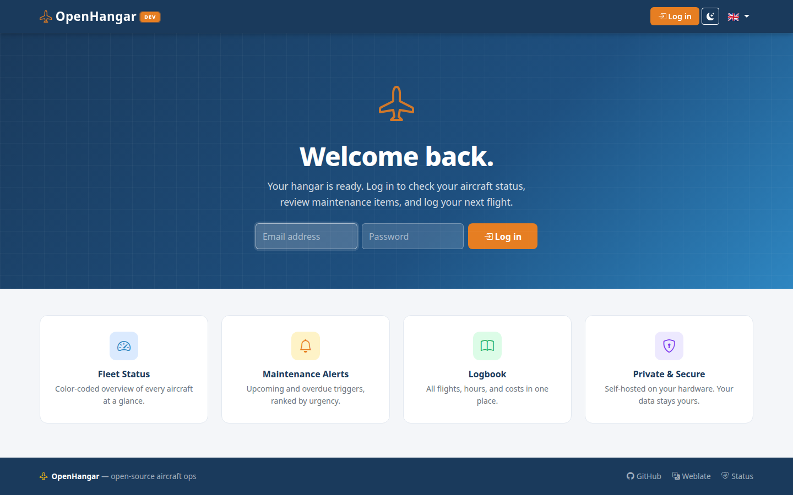

---

## Operating models

The operating model is chosen once during first-time setup and tells the app how to organise your data and which features to show.  You can change it later in **Configuration → Usage profile**.

| Model | Who it's for | Features enabled |
|---|---|---|
| **Sole pilot (logbook only)** | A pilot who wants a personal logbook without managing any aircraft | Pilot logbook only — no aircraft, maintenance, expenses, or fleet features |
| **Sole operator** | An individual who owns and manages one or more aircraft | Full aircraft management, maintenance tracking, expenses, documents; optional rental to others |
| **Shared ownership** | Two or more co-owners of one or more aircraft | As sole operator, plus co-owner accounts with shared access to the fleet |
| **Flight club** | A member-based flying club | Multi-user, shared fleet, club name branding, member management |
| **Flight school** | A training organisation | Multi-user, shared fleet, school name branding, instructor and student roles |

Changing the model only adjusts which features the interface shows — your existing data is never deleted.

Each person you then invite to your installation is assigned a **role** that controls what they can personally see and do, independently of the operating model.  See [Roles & access control](#roles--access-control) below.

---

## Key features

- **Fleet management** — model airframe, engines, props, and avionics; lightweight placeholders for quick onboarding; archive a retired aircraft without losing its history.
- **Maintenance tracking** — calendar and hours-based triggers with a clear green/yellow/red dashboard status; engine and propeller TBO and life-limited component tracking.
- **Flight logging** — one unified form that fills the aircraft and pilot logbooks together; counter pre-fill, photo proofs, fuel and oil tracking, GPS-file autofill.
- **Pilot logbook** — EASA FCL.050 layout with passenger/night currency tracking, FSTD/simulator sessions, and bulk import from CSV or Excel.
- **GPS tracks** — import GPX (also as written by cameras and phones, e.g. a GoPro's GPS exported with ExifTool — bad fixes while the GPS starts up are left out), KML, or Garmin CSV files; SkyDemon's GPX/KML exports work as they are, `.gpx.bin` name included; per-flight maps, a cumulative track view, and downloadable track images and animations. Each uploaded file — whether from a GPS import or attached in the flight form — is also kept unchanged (and included in backups), so it can be reprocessed later — the database only holds a simplified track. A flight's original file can be downloaded from its page, and all of an aircraft's (GPS import history page) or all of your own (My Flight Tracks page) as one zip; the configuration page shows how many are kept and their size. A flight can have several GPS files (for instance when the logger restarted in flight): they're combined into one track. A ground-only recording (engine running, never airborne) becomes the track of a logged ground entry, or — within 45 minutes before a departure or after an arrival at the same airfield, e.g. a taxi to the fuel station or customs — a taxi part of that flight's track, which never changes the flight's times; one further away (up to 3 hours, same day and airfield) is offered with those flights to choose from. A GPS file uploaded later on a saved flight (from its edit form) is added to its track the same way — as a taxi part when it's only ground movement — and never changes the flight's recorded data; the form shows the GPS times, should the flight's times need correcting by hand. The aircraft's flight log and your pilot logbook can be filtered by GPS track (with/without), date range and crew — handy to find the flights still missing a track. A flight's page lists its GPS files with their times; **Remove file** takes one off the flight (for whoever can edit the flight): its part of the track and map comes off, and the file is kept for 7 days in **Removed GPS files** (linked from the flight's page and the configuration page), where it can be restored with its part of the track — after that it's deleted. Undoing a GPS import works the same way, and only removes what that import added. Linking GPS data to a flight already in the logbook never changes its recorded times or date, and **Accept all best matches** on the review page links every segment that matches a logged flight in one go. The **Data checks** page (Configuration → Data checks, for admins and owners) then crosses each flight with its GPS track — airfields far from where the GPS took off or landed, a different date, a track well outside the logged times — and lets you correct the flight with the GPS value (a note on the flight keeps what the paper logbook says) or dismiss the difference. It's checked daily; a bell next to Configuration in the menu shows when there's something to review.
- **Airworthiness** — track ADs, SIBs, ARC, and installed STCs per aircraft, with automatic daily sync from the EASA Safety Publications Tool.
- **Snag tracking** — log defects, flag grounding items, and see them fleet-wide before the next flight.
- **Reservations** — per-aircraft booking calendar with owner approval, conflict detection, and cost estimation (shown when rental is enabled).
- **Mass & balance** — per-aircraft envelope configuration and loaded CG calculation with a visual envelope chart.
- **Cost tracking** — expenses with receipt attachments, recurring fixed costs, and an operating-cost dashboard computing the true hourly (wet) rate.
- **Document management** — attach PDFs and photos to aircraft, components, pilots, and logbook entries; inline viewer; sensitive-document controls hide files from renter/viewer roles; Syncthing-friendly on-disk layout.
- **Share links** — passwordless read-only aircraft status pages with QR codes, for notice boards or your maintenance shop. Revoking a link blocks subsequent page and photo requests. Shared pages and photos are not stored in the browser HTTP cache; revocation cannot erase copies a recipient has already downloaded or saved.
- **Email notifications** — per-user preferences for maintenance, airworthiness, reservation, pilot-currency, and crew-confirmation alerts.
- **Progressive Web App** — installable on mobile; recently opened pages and a read-only copy of your aircraft and pilot logbooks stay readable offline.
- **Security** — role-based access with per-aircraft permissions, optional TOTP 2FA, and encrypted AES-256-GCM backups with built-in scheduling and retention (see [backup & restore guide](backup_restore.md)).
- **Multi-language** — English, French, Dutch; language selectable per user.

---

## Getting around

Once logged in, the **Dashboard** gives you a fleet overview: status badges per aircraft, recent flights, maintenance alerts, and pilot currency summary.

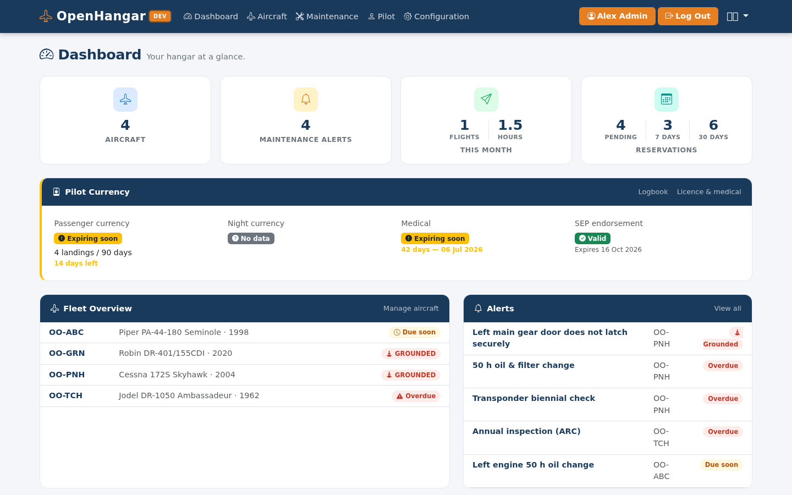

The navbar provides access to:

| Section | What you can do |
|---|---|
| **Dashboard** | Fleet overview, alerts, quick stats, and your pilot currency summary |
| **Aircraft** | Manage the fleet — components, flights, snags, documents, expenses, mass & balance, airworthiness, share links |
| **Log a flight** | Unified flight entry that fills the aircraft and pilot logbooks in one step |
| **Maintenance** | Fleet-wide maintenance overview and per-aircraft triggers |
| **Pilot** | Personal logbook, pilot profile & documents, logbook import |
| **Airfield passports** | Build and manage personal airfield collections with a selection map; view passports you own or have accepted membership in |
| **Configuration** | Users & permissions, notifications, backups, email, tenants *(administrators)* |

The per-aircraft booking calendar (**Reservations**) is reached from the
dashboard and aircraft pages when rental is enabled in your usage profile.

**On a phone**, the navbar above becomes a bottom tab bar (Dashboard,
Aircraft, Log a flight, Pilot) plus a menu (hamburger icon, top right) for
everything else. Pages with several toolbar actions collapse the less
common ones into a **More** menu, and a page's main action (Upload
document, Add item, …) follows as a round button in the bottom-right
corner so it stays within easy thumb reach. Wide tables — a calendar
grid, an aircraft's documents list — scroll horizontally within their own
card instead of the whole page; everything else reflows to fit the
screen.

---

## Key user flows

### First-time setup

1. An administrator creates the organisation and the first user account (owner).
2. Add aircraft — choose lightweight (registration only) or full model (airframe + engines + props + avionics).
3. Define maintenance triggers for each aircraft (date-based or hours-based), and optionally TBO / life limits on engine and propeller components.
4. Start logging flights.

The fleet is visible at a glance on the **Aircraft** page:

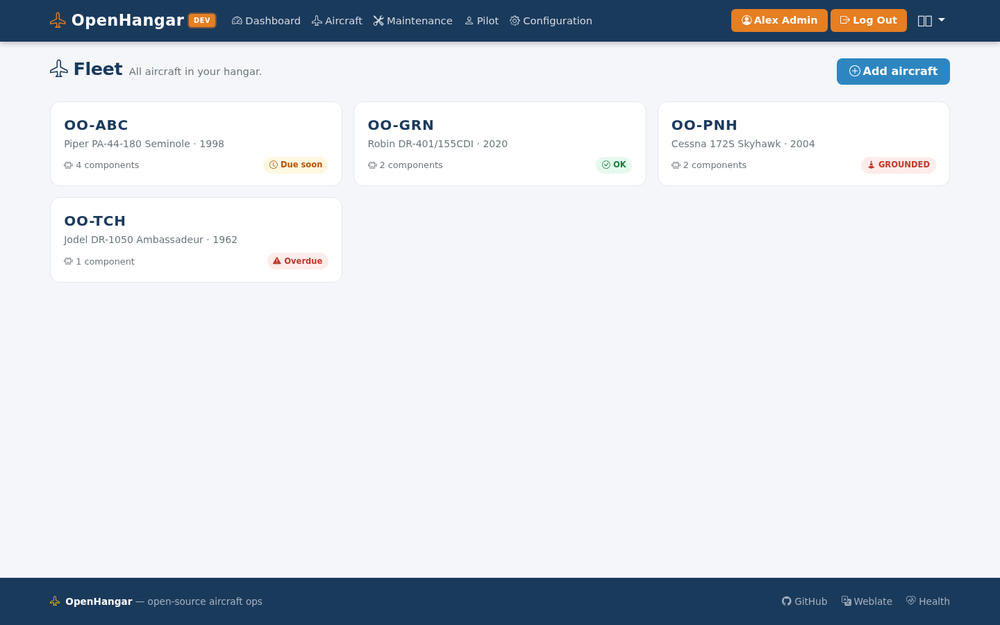

Each aircraft has a detail page showing current status, components, recent flights, and documents:

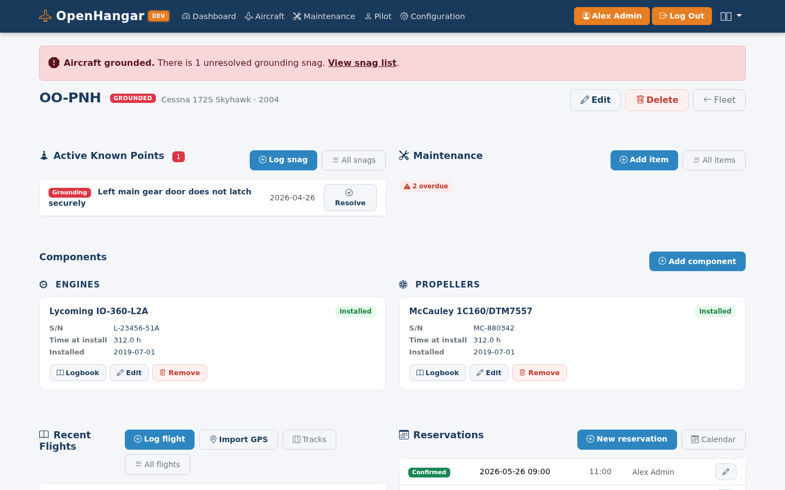

### Logging a flight

1. Click **Log a flight** in the navbar.
2. Check the pre-filled counter start values and enter the end values (flight and engine time counters); attach a photo of the instruments, or upload a GPS file to autofill times and route.
3. Save — the system updates component totals and re-evaluates all maintenance triggers automatically. If you were flying, the same form creates the matching entry in your personal pilot logbook.

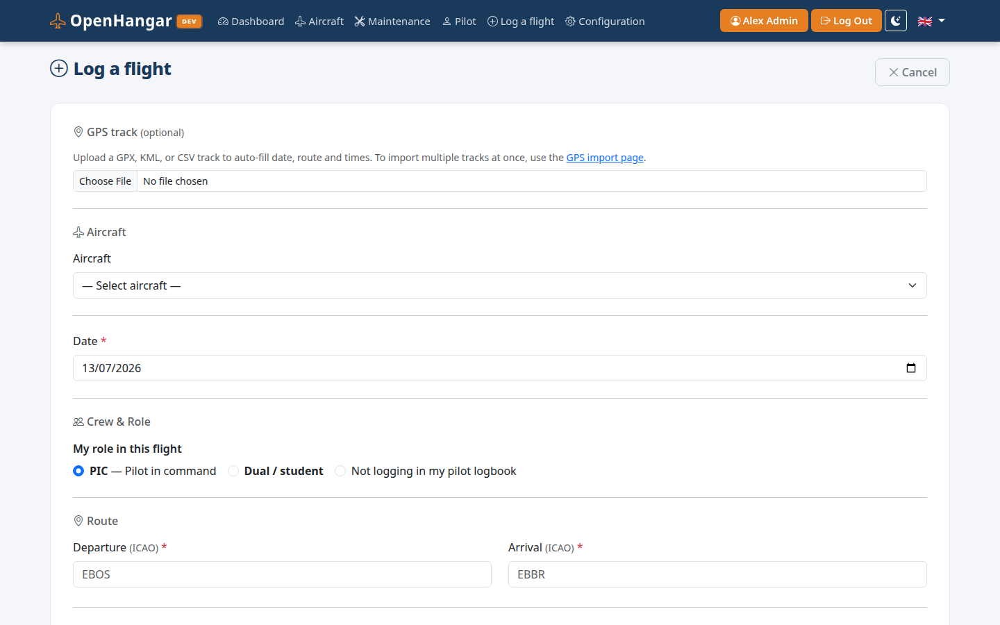

The **Aircraft logbook** shows all flight entries for a specific aircraft (journey log):

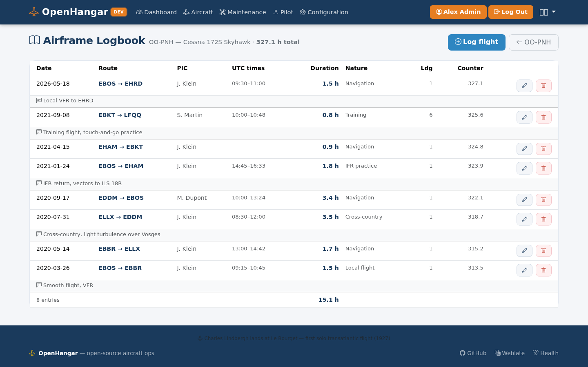

The **Pilot logbook** view shows your personal flight history with EASA FCL.050 column mapping:

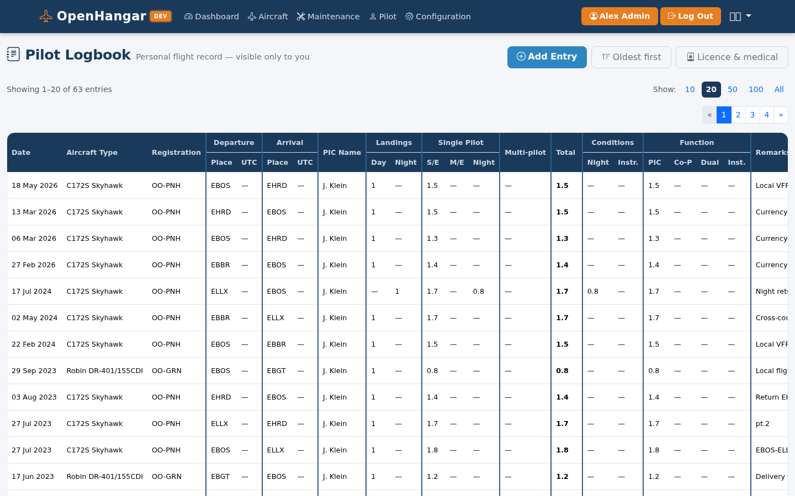

#### Flights with another pilot on board

The **PIC / Commander** and **Second crew** fields on the *Log a flight* form suggest the pilots of your organisation as you type, and still accept any other name. When you pick a colleague who has an OpenHangar account, they are asked to confirm the flight in their own logbook:

1. They receive an e-mail (they can switch this off under **Configuration → Notifications** — *Flight crew confirmation request*).
2. The flight appears under **Flights waiting for your confirmation** on their dashboard and pilot logbook, and a badge shows on the **Pilot** menu item.
3. **Confirm** adds the flight to their pilot logbook, with their function time (PIC, instructor, co-pilot or dual) taken from their role on the flight. **Decline** leaves only their name on your entry.

Until they confirm, the flight does not count towards their hours or currency. Changing or removing their name before they answer withdraws the request. You get an e-mail when they confirm or decline (*Flight crew confirmation answered*).

Once confirmed, the flight's details — date, route, times, landings, night and instrument time, remarks — are **shared**, and only the pilot who logged it edits them; the other pilot is e-mailed a summary of what changed (*Shared flight changed*). Each pilot keeps **their own part** of the flight: their name, role, function time and a personal remark. Open it with the *My part of this flight* button (person icon) in the pilot logbook or on the entry's detail page; changing it never affects the other pilot. If you are not the pilot who logged the flight and a shared detail is wrong, use **Suggest a correction** on that same page: the logger sees it under *Suggested corrections to your flights* on their dashboard and logbook (and by e-mail) and can accept it — applying it for both of you — or reject it. On a flight in a managed aircraft, times and flight time follow the aircraft's counters, so ask the logger to correct those directly.

It also works the other way round. If you log a flight on one of your organisation's aircraft and the *Possible duplicate detected* warning shows that someone else already logged it with you on board, click **Ask to be added to this flight** instead of *Create anyway*. The pilot who logged it sees your request under *Pilots asking to be added to your flights* (and by e-mail) and approves or declines it; once approved the flight is in your logbook with your role and function time.

Removing a shared flight only ever removes it **for you**: if the other pilot also has it in their logbook, deleting it from your logbook just takes you off the flight and leaves their entry untouched. Likewise, deleting a flight from an aircraft's logbook, undoing an aircraft or GPS import, or deleting an aircraft never deletes pilots' hours — flights that are in someone's pilot logbook are removed from the aircraft's log but stay in that logbook as a flight on another aircraft, with the registration and type kept.

The **Mass & balance** page lets you record and verify CG position before a flight:

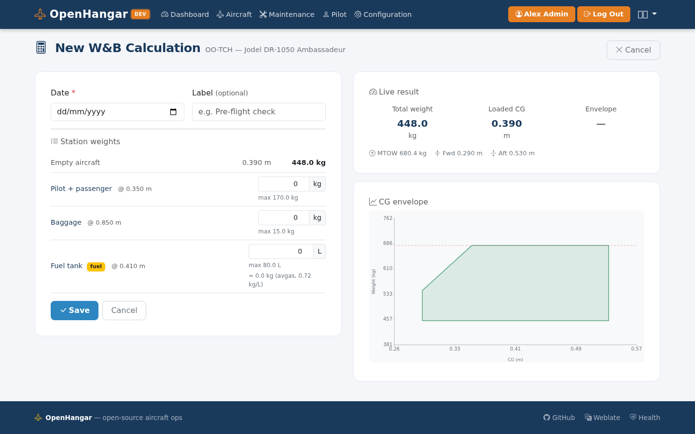

### Sharing a file or link to OpenHangar

Once OpenHangar is installed as an app on an Android phone (in Chrome: **Install app** or **Add to Home screen**), it appears in the phone's **Share** menu. Share a PDF or photo to it, from your e-mail, files or camera, and OpenHangar asks what it is — only the choices your role allows:

- **Aircraft document**: saved at once in the aircraft's documents (several files can be shared together).
- **Expense receipt**: opens the new-expense form of the aircraft you pick, with the file attached as its receipt.
- **Maintenance record**: opens the aircraft's maintenance list; press the tick on the item you serviced, and the file is saved with the aircraft's maintenance documents when you save the service record.
- **Flight photo**: opens the new-flight form with the photo attached; choose which photo it is (flight counter, engine counter or fuel, before or after the flight).

Share a **link** instead — an Instagram reel, a YouTube video or a web page about a place you'd like to fly to — and OpenHangar opens a **new place** with the link filled in and a title suggested from the shared text, in your default collection. Tracking parameters are removed from the link, and OpenHangar never opens it itself. Add the location now or later (address search, the map, or coordinates), or just press Save to keep the link and locate it another day. This also works for Personal accounts.

Nothing is saved until you save the form, and the form's **Shared file** box can be unticked to leave the file out; a file you choose on the form yourself takes its place. **Cancel** on the share page, or **Discard** on the maintenance list, drops the shared file; one left unused is deleted after a day. iPhone browsers don't let web apps receive shares: upload the file from the form instead, or copy the link and paste it into a new place's **Website** field.

### Working offline

OpenHangar needs a connection to save anything, but you can still **read** while offline. Pages you opened recently while online stay available (and on a slow connection they appear after a few seconds from the saved copy, then refresh), and each logbook you open online is also saved on your device as a read-only copy — there is no "go offline" button to remember. If you then lose connectivity (no signal on an airfield, a hangar with poor reception), open **Offline logbook** from an aircraft's logbook page or from your Pilot logbook page to read the whole logbook: every flight, not only the pages you had opened. The page says when its copy was saved; it is refreshed each time you open that logbook online.

Your offline pilot logbook shows all your flights: in fleet aircraft, in other aircraft, and FSTD/simulator sessions. On a flight shared with another pilot, it shows only your own function hours and remarks, as the online logbook does.

Forms can't be saved offline: a form you fill in while offline shows a plain "you're offline" message instead of failing silently, so reconnect and submit it again. Firefox in a regular browser tab works fine; installing OpenHangar as an app is optional and only changes how it looks, not what works offline. A browser profile set to permanently private browsing (e.g. Firefox's "Always use private browsing mode") disables offline access entirely, since browsers block Service Workers outright in that mode — use a regular profile if you need offline access. Offline copies live unencrypted in the browser's local storage, so avoid reading logbooks offline on a shared or public device.

### Importing an existing pilot logbook

If you have a previous logbook in a spreadsheet (CSV or Excel), OpenHangar can import it in a few steps:

1. Navigate to **Pilot → Import logbook**.
2. Upload your CSV or Excel file.

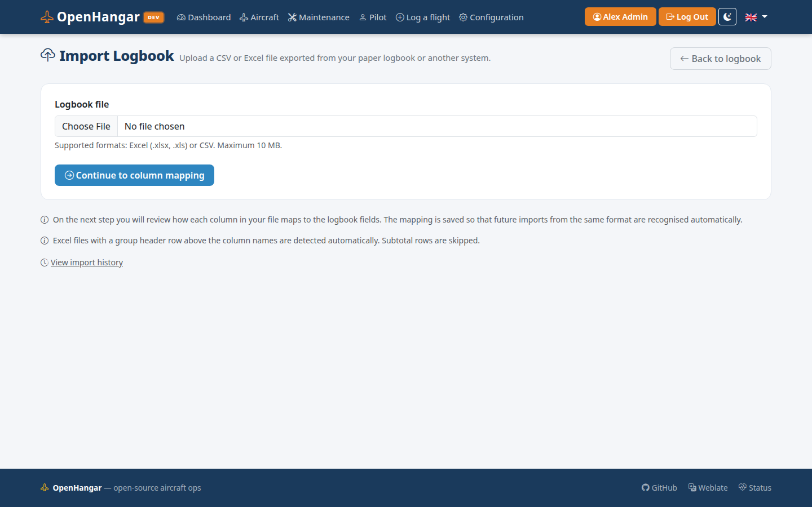

3. Map each column in your file to the corresponding OpenHangar logbook field using the dropdown selectors.  OpenHangar remembers the mapping the next time you upload a file with the same structure, and pre-fills the dropdowns automatically with a notice "recognised from a previous import — please verify".
4. *(Optional)* If your file does not cover your full flying history, check **"I already had hours before this file starts"** and enter cumulative totals for each time category.  OpenHangar will create a single synthetic "Opening balance" entry dated one day before the earliest imported row.
5. Review the import summary: rows imported, subtotal rows skipped, and any rows that could not be parsed (with the reason).  Click **Confirm** to save.

Sub-total rows (rows where the date cell contains "TOTAL", is blank, or contains a running sum) are detected and skipped automatically — they do not need to be removed from the file beforehand.

A cell containing the literal text `[empty]` (a common transcription convention for "deliberately left blank on paper") is read as a blank cell, in both the pilot and the aircraft logbook import.

When a flight in your file is already in a managed aircraft's logbook (for example from an aircraft logbook import), the two are merged into one flight instead of being logged twice — matched on the route and the block/takeoff times. A flight cancelled after engine start, with no takeoff, is matched too: same day and airfield, no landings, zero airborne time in the aircraft log, and your logged block time equal (±0.1 h) to the engine counter difference. Re-importing either file afterwards adds nothing.

#### Import history and rollback

Every import is recorded on the **Pilot → Import history** page.  If you imported incorrect data, click **Delete this import** to remove all entries that belong to that batch in one operation — your manually-entered entries are never affected. An imported flight that another pilot has since confirmed in their own logbook stays there; it is only removed from yours.

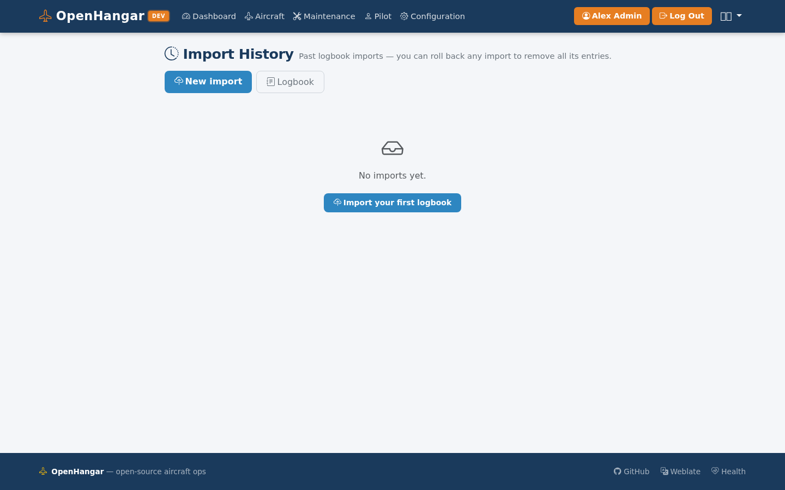

---

### Airfield passports

Open **Airfield passports → Create passport**. Name the passport and optionally
limit its dates, then choose countries/regions, search by name or code, paste
codes, or add a missing airfield. Check the selected list and map, choose
**Review passport**, then save. You can also preview a public list URL or the
Landegutscheinheft publisher source in the builder, then merge or replace the
selection. Imported replacements keep saved visit/photo targets. Source URLs and
retrieval dates are retained as provenance; publisher descriptions are not imported.
Unreleased or unsupported sources offer a pasted-code fallback. Unknown codes require correction or explicit
removal. Military/ULM classification can remain unknown or be entered manually.

Friends with Personal accounts can build their own passports and prepare
a linked next edition too. A friend who flies can also keep a personal pilot
logbook on the same account (**Start my pilot logbook** on the passports page):
their logged arrivals then fill their passports automatically. It holds only
their own flights and gives no access to your aircraft, reservations,
maintenance or other pilots' logbooks. By default an administrator enables it
from the user list; under **Configuration**, you can let account holders start
it themselves. Their military/ULM labels apply to their own passport;
public airfield details do not reveal another collection’s private corrections.

Only the owner can edit, archive, reopen or delete a passport. Editing previews
changes to your completion; removing an airfield with saved visits or stamp photos
requires confirmation. Deleting a passport keeps your flight logbook. The builder
supports normal forms without JavaScript and keeps its draft on the server for
two hours.

On **Airfield passports**, choose **Export my passport data** to download a ZIP
with your records and stamp photos for this organisation. It includes your
retained evidence after withdrawal, without exposing the group’s later private
changes. Missing photo files are marked in the export. Other friends’ private
evidence is excluded, including when you own the group.

A group airfield’s **Group airfield discussion** is visible to active members of
that group, including friends who join later. Ask a question before visiting,
share flying tips or recommend somewhere nearby. An optional experience date
helps others judge how current your advice is. The conversation continues across
editions, independently of the visit years selected on the map. Private visit
and flight notes are never copied into it. These are personal experiences;
check current official airfield publications before flying.

Authors can edit or delete their comments; the group owner can remove them but
cannot rewrite another person’s words. Leaving the group ends your access while
keeping your comments visible to its members. Deleting your account removes your
comments. Your personal data export includes your own comments only.

Open a manual visit’s **Edit manual visit** form to correct its date or note,
or change its supporting flight. Removing that link keeps the visit as an
independent manual entry; editing the visit never changes the flight itself.
Archived editions stay read-only.

Choose **Print passport** for a paper copy or a PDF saved through your browser.
The preview shows your own completion and first visit dates. Tick any of your
stamp photos you want to include, then update the preview. Photos are omitted
by default and do not count as visits. Private flight/visit notes and other
participants’ photos stay out. The selection form also works without JavaScript;
use the browser’s Print command in that case.

Use **Download GPX waypoints** or **Download KML waypoints** to take open,
unvisited destinations into a navigation or mapping app. The download follows
your current edition filters or the results in **Where next?**. Airfields without
usable coordinates are listed separately and omitted. Files contain names,
codes and coordinates, without flight tracks, visit notes or friends’ details.

Your own logbook arrivals fill the passport automatically; dates, crew membership
and edits are checked live. Arrivals are assumed full-stop: open an airfield to
exclude a touch-and-go or low approach. You can also record a dated manual visit,
optionally linked to your own flight, and upload a private stamp photo. On a
phone, **Record a visit** on the passport page is the quickest way: choose the
airfield and date, add a note if you like, and save. Photos do not earn credit.
On a group passport you can share a photo with the edition's other participants
(**Share with this group**) and stop sharing at any time; uploading a new photo
makes it private again. The default map gives every visited field equal weight;
**Show visit frequency** sizes markers by recorded visit counts. Closed
unvisited fields remain visible but are excluded from the achievable total.

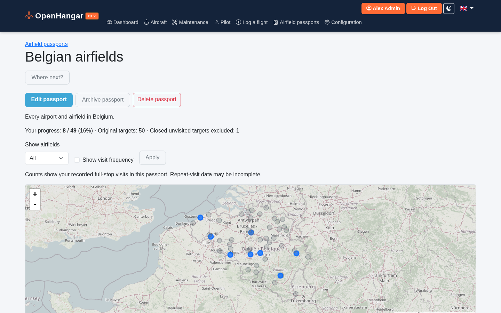

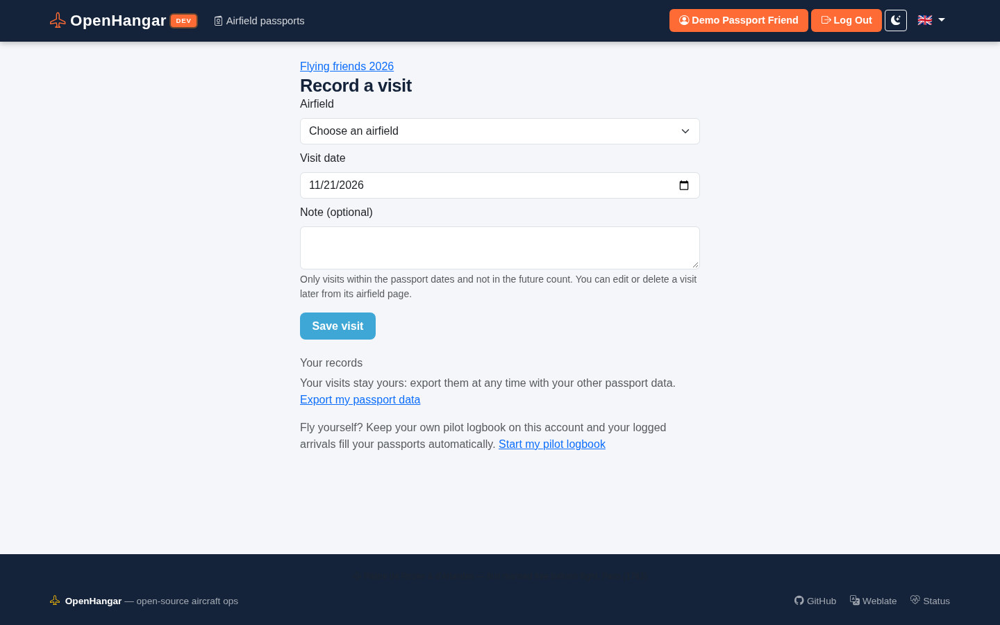

Use **Where next?** (in the **Explore** menu, or from a passport's page) to find
open unvisited fields within a distance or still-air time limit, across all your
active passports or the ones you tick, and the airfields linked to your places
(**Search in** places, passports or both; visited places are left out unless you
include them). Each airfield is listed once with all its reasons — "Not yet
stamped in *Belgian passport 2026*", "4.0 km from *Pairi Daiza* (taxi)" — and at
equal distance the airfields with more reasons come first. Places with no
airfield yet are counted, so you can link one. You can save a home airfield on your pilot profile and a home/cruise
speed on an aircraft, or use session-only inputs. Optional range estimates need
explicit usable fuel, flow and reserve assumptions.

Link successive editions to revisit earlier lists or combine their maps, with
newest/oldest visit colours and optional frequency weighting. In a group, frequency
counts your own visits unless you choose the whole group or one participant under
**Count visits by**. Your own voucher
allowances stay separate from your friends’ balances.

Linked group editions also show a comparison of the airfields added/removed,
coverage by anyone and everyone, and each sharing participant's progress. Every
edition has its own percentage and closure adjustment. Including earlier
read-only history adds only the visits shared with you; it does not join that
edition or give you its stamps or vouchers.

To invite existing account holders, enable **Group visit sharing**, then open
**Invite friends** on the passport and copy its invitation link. Friends choose a
group display name and sharing consent, then sign in and join that edition. A
signed-in friend simply selects **Join this passport**. You can replace, expire or
disable the link without removing existing participants.

A shared edition shows **Group progress**: airfields visited by anyone and by
everyone, and a leaderboard of each participant's coverage, all measured against
the same airfields (open ones, plus closed ones someone visited). Use **Show
airfields** and **Visited by participant** to narrow the map and list; your own
progress and marker styles stay yours. See [the passport guide](airfield_passports.md#group-progress-and-filters).

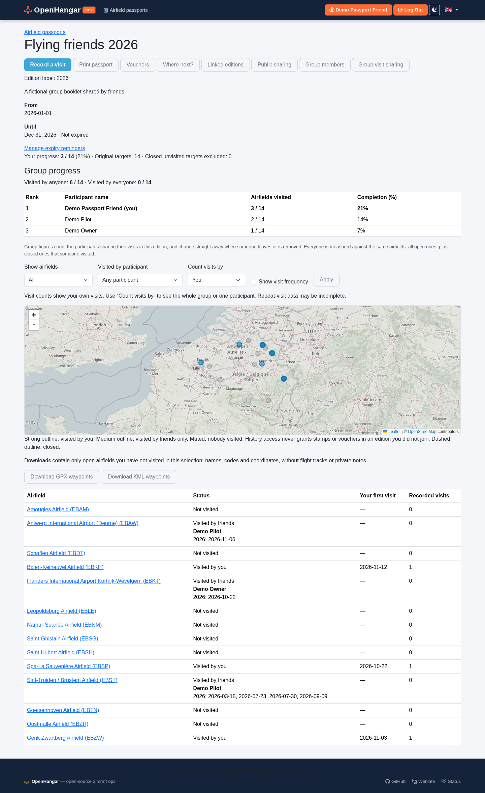

A friend without an account selects **Create an account and join this passport**,
chooses a password and verifies the code sent to their email. They then complete
any required authenticator setup and open their own map. Their new account can
record passport visits and manage its own security; it has no fleet role. The
instance needs working SMTP settings for verification emails. See
[the passport guide](airfield_passports.md).

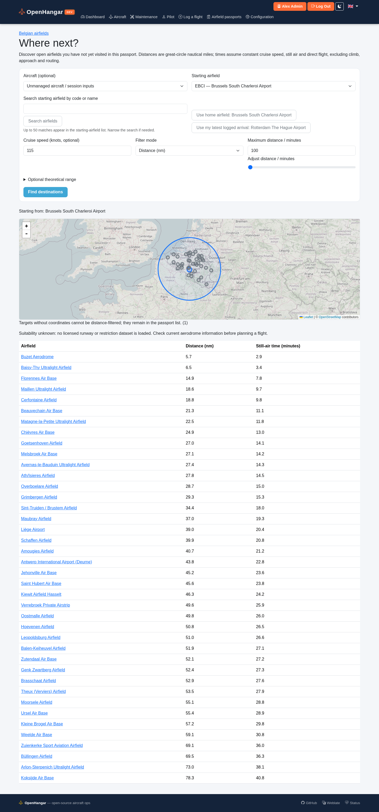

### Places

**Explore → Places** collects places worth flying to — a town, a theme park, a
restaurant, a viewpoint — as pins on a map. Places have nothing to do with the
aircraft: every account has them, Personal accounts and viewers included.

- **Collections:** your own **My places**, plus any number of collections you
  share with chosen users of the instance ("Our places", "Club fly-outs"…).
  Members are editors or readers; what you can do with a place depends only on
  the collection, never on your role.
- **Adding a place:** drop a pin on the map, paste coordinates or a map link,
  search an address, or just save a link (from a phone share, see below) and add
  its location later. Tags, a photo, an address and a website are optional.
- **List and map** of one or all collections, filtered by tag, visited or not,
  archived, or still to locate; places without a location stay in the list but
  not on the map.
- **Downloads:** the places of the list as filtered, as GPX or KML waypoints
  (names and coordinates only). Your personal data export (on the airfield
  passports page) also holds the places you own, their tags and photos, your
  own visits, and the collections you belong to — not other members' places.

### Personal minimums

Alongside the legal limits, most pilots fly to a stricter set of **personal minimums** — self-imposed limits on wind, weather, and other conditions that guide go/no-go decisions. OpenHangar keeps this document next to your logbook instead of on a piece of paper:

1. From **Pilot → Personal minimums**, start from a **blank**, **light**, or **full** template — each is just a starting structure of sections and items, all editable and removable afterwards.
2. Fill in your own values, optionally tagging an item with a semantic meaning (e.g. "days since last flight") so OpenHangar can compute it automatically from your logbook and warn you when you're outside your own comfort zone.
3. **Publish** when ready — this stamps the revision with today's date and your current total flight hours, and supersedes the previously active revision (kept, read-only, in your history, so you can see how your minimums evolved with experience).

Minimums are never edited on the day of a flight — the "Log a flight" form shows your active minimums in a read-only, collapsible panel for reference only. A recency reminder appears on your logbook page (and can trigger an email notification) when a tagged threshold is exceeded, e.g. more days since your last flight than your own comfort-zone limit.

### Monitoring maintenance

- The dashboard shows a colour status badge (green / yellow / red) per aircraft.
- The Maintenance list view sorts items by urgency: overdue → due soon → scheduled, grouped by which engine/propeller/component each item is scoped to (or "Airframe / general" for items that aren't).
- Overdue items also appear as alerts on the dashboard.

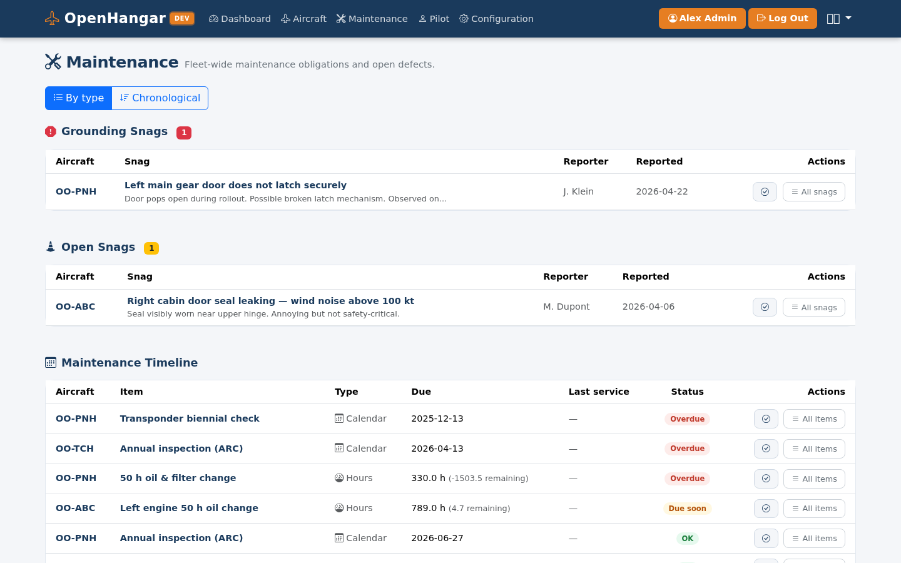

### Importing an Aircraft Maintenance Programme (AMP)

If you've built a structured maintenance task list for your aircraft — e.g.
by comparing it against a sister aircraft's programme and your shop's
tracking export — OpenHangar can import it as the aircraft's tracked
maintenance schedule, and later export it back out as a document matching
the official EASA Form AMP layout (AMC2 ML.A.302). **Import from
spreadsheet**, **AMP declaration**, and **Export AMP** are all on the
aircraft's Maintenance page. See
[the AMP import/export guide](maintenance_import.md) for the spreadsheet
template, the interval syntax, and the full import/export flow.

### Tracking airworthiness

Each aircraft has an **Airworthiness** page tracking Airworthiness Directives, Safety Information Bulletins, the ARC, and installed STCs.  Components are mapped to EASA Safety Publications Tool entries; a daily sync pulls newly published documents and marks them *pending review*, and each document then moves through a compliance workflow (complied / not applicable / deferred / question for your maintenance organisation).

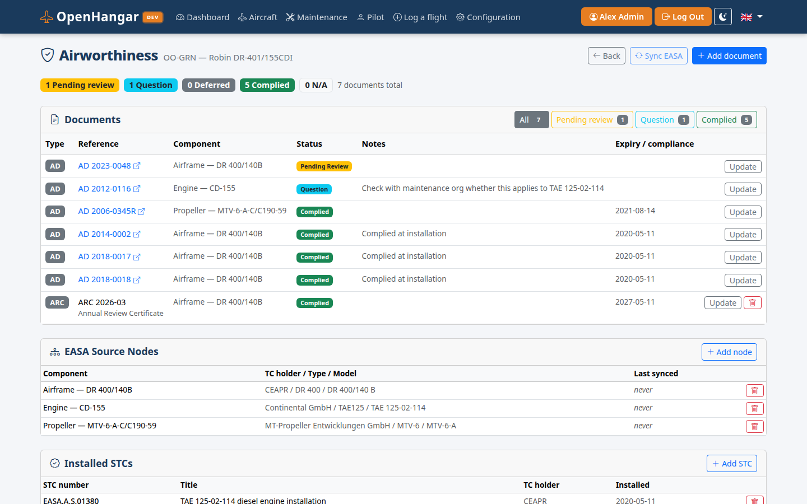

### Insurance and the Airworthiness Review Certificate (ARC)

An aircraft's insurance and ARC status are both driven by documents, not by a
manually-typed date: upload the current insurance certificate or ARC (via the
aircraft's Documents section, or the quick "Upload cert" button in its
Insurance/ARC panel) with a **Valid until** date, and OpenHangar tracks the
expiry from there. To renew, use **Replace** on the certificate in force in the
Documents list (or just upload the new one with the same document type).

The same rules apply to an aircraft's insurance and ARC and to a pilot's
medical certificate and licence (see [Pilot documents](#pilot-documents)):

- **In force** is the certificate that has started (its **Valid from** date has
  arrived, or it has none) and is valid the longest. Uploading an older
  certificate for your records never displaces the current one.
- The others are kept on file, marked **superseded** — still viewable and
  downloadable, for archival.
- A renewal uploaded ahead of time, with a **Valid from** date still in the
  future, is shown as **upcoming**: the current certificate stays in force
  until that date, then the renewal takes over and the old one is marked
  superseded (checked daily, so it happens on its own).
- As long as a renewal on file starts no later than the day after the current
  one ends, there is no "expires soon" warning or reminder — coverage is
  counted through the renewal. A real gap between the two is still reported.

A lapsed insurance certificate or ARC marks the aircraft **grounded**, exactly
like an open grounding snag — reservations warn or block the same way, and
both send an "expiring soon" reminder email (default 30 days ahead for
insurance, 60 days for the ARC; configurable per user under **Configuration →
Notifications**).

### Pilot documents

Your **Pilot profile** keeps your licence, medical certificate and other
personal documents (always marked sensitive). A medical certificate or licence
follows the same lifecycle as an aircraft's insurance and ARC (see above):
**Replace** on the one in force uploads its successor, the old one stays on
file as superseded, and a renewal can be uploaded ahead of time with a future
**Valid from** date.

Once a medical certificate is uploaded, it drives the **Medical expiry** on
your profile (the field becomes read-only) and so the "medical expiring"
reminder: no reminder while the next certificate is already on file.

### Understanding operating costs

The **Cost dashboard** (linked from the aircraft's Expenses section) splits expenses into fixed and operating categories and divides them by the hours actually flown, giving the true all-in hourly (wet) rate over a selectable period.

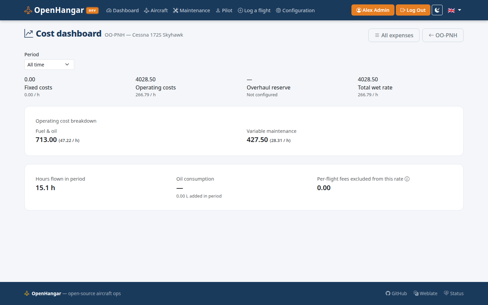

Paid abroad in another currency? Record the expense in the amount actually charged to you (for example the euros on your bank statement), and open **Paid in another currency?** on the expense form to note what you paid at the counter (for example in GBP). That second amount is for your records only — it's shown next to the expense but never used in any calculation.

### Booking an aircraft

When rental is enabled in your usage profile, each aircraft has a **booking calendar**.  Pilots request a slot; the owner confirms or declines, with automatic conflict detection and a cost estimate based on the aircraft's hourly rate.

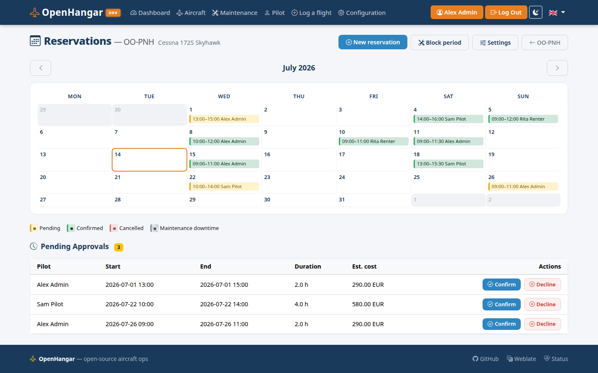

Creating or confirming a reservation on a **grounded** aircraft (an open grounding snag, expired insurance, or an expired ARC) shows a warning; a per-tenant setting can escalate this to a hard block for renters — owners are always allowed to proceed, since they may be booking the aircraft for the shop visit itself. Owners can also block out a period for planned maintenance downtime (e.g. an annual inspection) directly from the calendar; it conflicts with confirmed reservations the same way another confirmed reservation would.

### Renting your aircraft

For a sole operator who rents or lends their aircraft to other pilots, OpenHangar closes the loop from booking through to settlement: **authorize → reserve → check out → fly → check in → charge → settle.**

1. **Authorize renters.** From **Configuration → Renters**, record who is qualified to fly which aircraft (or the whole fleet), when the authorization was granted and when it expires, and the checkout flight that verified it. This is an owner-entered fact, not an automatic read of the renter's private pilot profile.

   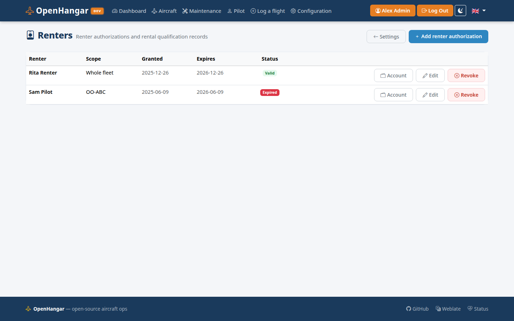

2. **Check out and check in.** When a renter's reservation comes up, the check-out step captures counter readings, fuel state, and confirmation that the walk-around and the open-snag list were reviewed. Check-in captures the return counters and compares them against any flights logged during the rental window, flagging a discrepancy if they don't match.

   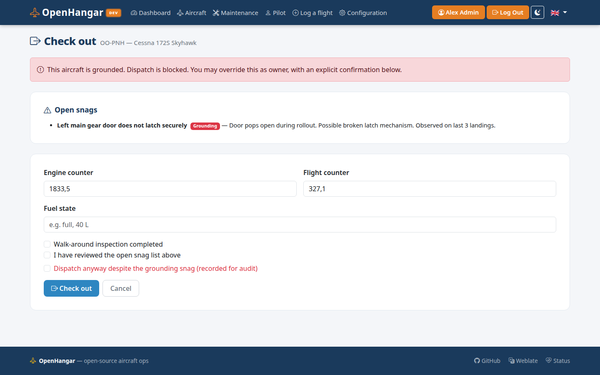

3. **Review and finalize the charge.** OpenHangar drafts a rental charge automatically at check-in from the counter delta and the aircraft's rate settings (wet/dry, engine or flight time, minimum hours per day). The owner reviews the draft — adjusting hours, rate, or fuel credit if needed — and finalizes it, which posts a single, permanent entry to the renter's account. A finalized charge cannot be edited; corrections go through a reversal instead.

4. **Track the balance.** Each renter has a running account: finalized charges minus payments received. Owners record payments manually from the renter's account page; renters see the same balance and statement from their own **My account** page. Either view can export a CSV statement for a given period.

   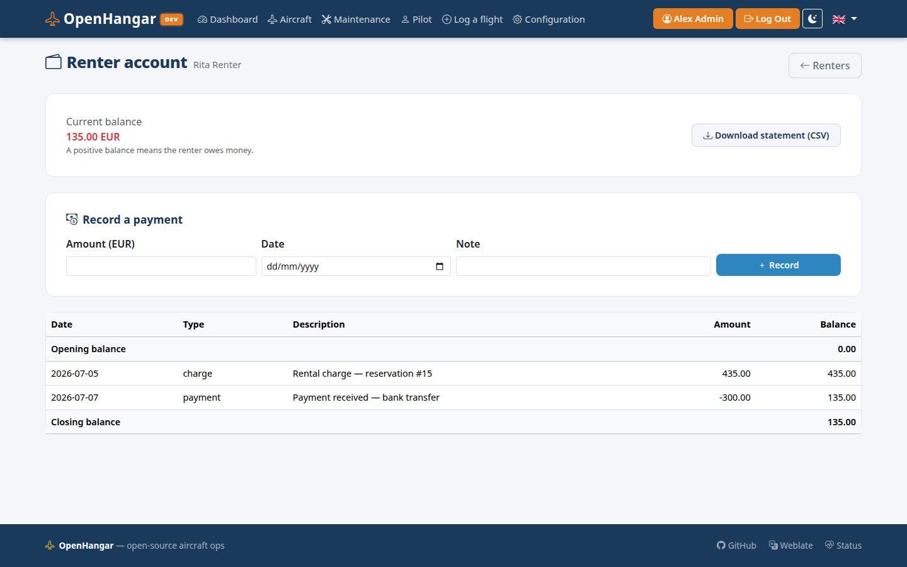

### Sharing ownership of an aircraft

When the **Shared ownership** operating model is in use, two or more people can co-own an aircraft, each holding a defined share and their own capital account.

1. **Define the owners.** From the aircraft's **Manage owners** page, list each co-owner with their share percentage and buy-in amount (their initial capital contribution). Shares across all owners must sum to exactly 100%. This is also where you set the co-owner hourly rate and the billing start date — expenses and flights dated before that start are never billed.

   

2. **The two cost tiers.** OpenHangar keeps two kinds of cost apportionment separate, following the standard co-ownership model:
   - **Fixed costs** — insurance, hangar fees, the annual inspection — are split among all co-owners in proportion to their share, regardless of who flew.
   - **Operating costs** — fuel, wear, and the aircraft's usage in general — are billed as flight hours × the co-owner hourly rate, charged only to whoever was PIC on that flight. A co-owner who didn't fly that month owes nothing for it.

3. **Follow the capital account.** Each co-owner's capital account is simply: buy-in + payments made − their share of fixed costs − their own flying. The **billing dashboard** (reachable from the aircraft page) shows every co-owner's hours flown, fixed and operating liability for the selected period, payments received, and current capital balance in one place, and flags any balance that's been negative for longer than your configured threshold (**Configuration → Usage profile**, shared-ownership tenants only).

   

4. **Record payments.** When a co-owner transfers money to the group (to top up their account or settle a negative balance), record it from the billing dashboard. Payments are permanent once saved — a mistaken entry is corrected with a "Reverse" counter-entry, not an edit.

5. **Snapshot a valuation.** At any point (typically end of year), record a **valuation snapshot** — an immutable capital-balance record for every co-owner as of that date. Because the underlying ledger is itself append-only, a snapshot never changes even as new activity is posted afterwards, so historical statements stay reproducible.

6. **Statements.** Each co-owner can view their own account and download a CSV statement from **My share** on the aircraft page; owners/admins can do the same for any co-owner from the billing dashboard.

CSV downloads preserve amounts and negative balances as numbers. Names, descriptions
and aircraft registrations that resemble spreadsheet formulas are prefixed with an
apostrophe in the exported file so they are treated as text. That apostrophe may
be visible when reading the raw CSV; the records in OpenHangar are unchanged.

### Managing documents

Upload any PDF, image, or document from the Aircraft or Component detail page.
Mark a document **sensitive** at upload time to hide it from renter/viewer roles
while keeping it visible to owners and admins. An expense's receipt is listed
with the aircraft's documents too, but only owners and admins see it, as they
alone see the expenses.

Backups, SMTP settings, and usage profile are managed from the **Configuration** page (administrators only):

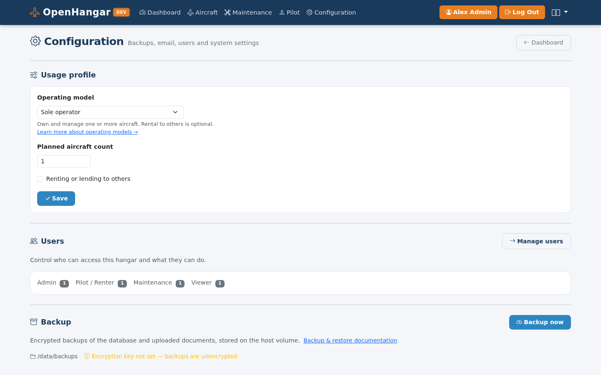

### Choosing your notifications

Every user picks which email notifications they receive — maintenance, airworthiness, reservation, pilot-currency, and crew-confirmation alerts — from **Configuration → Notifications**.  Administrators can additionally set fleet-wide defaults.

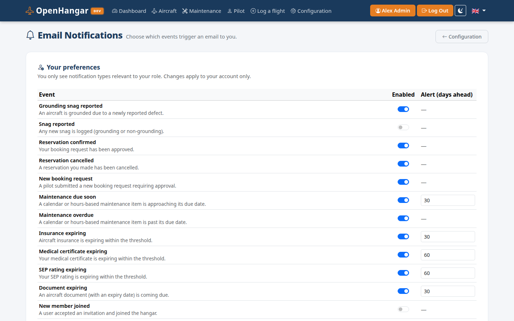

---

## Roles & access control

Roles are per-person settings within an installation — they control what each user can see and do, regardless of which operating model is in use.  A sole operator with a single admin account has the same role system available as a flight school with dozens of members.

OpenHangar uses a role-based model combined with per-aircraft access grants.

| Role | Summary |
|---|---|
| **Admin** | Full access to everything including system configuration |
| **Owner** | Full access to fleet, maintenance, flights, and user management |
| **Pilot** | Log flights, create reservations; access limited to assigned aircraft |
| **Maintenance** | View and update maintenance; access limited to assigned aircraft |
| **Viewer (read-only)** | Read-only access to aircraft, maintenance and flights (limited to assigned aircraft), plus personal features (passports, Places) |

Two additional roles — **Student** and **Instructor** — exist in preparation for the flight-school features.

A **Personal account** has no role at all: only the personal features (its own passports, Places, Where next?, profile and data export), with no access to the aircraft, reservations, maintenance or other pilots' logbooks. Friends who join through a passport invitation get one. For a non-pilot, choose:

- **Personal account** (invite them to a passport) when they only need passports and Places;
- **Viewer (read-only)** when they should also see the aircraft, maintenance and flights.

A Personal account can also keep its own pilot logbook (**Start my pilot logbook**, see the airfield passports section); its places and collections stay as they are.

When inviting a user, the owner selects their role and checks which aircraft they are allowed to access.  Admin and Owner roles automatically see every aircraft.

Beyond the base role, each user carries three capability flags: **pilot** (personal logbook, reservations, flight logging), **maintenance** (edit aircraft and components, manage maintenance), and **view-only** (removes all write access regardless of the other settings).  Administrators can also fine-tune a per-aircraft permission grid (view/edit aircraft, maintenance read level, flight logging, reservations, …) or grant a user access to **all aircraft, including ones added later**.  See the [access control reference](access-control.md) for the full model and the default permissions per role.

The aircraft detail page adapts to each role: the sections shown, the actions available, and the order in which sections appear all change depending on who is viewing.  See the [aircraft detail layout reference](detail_layout_aircraft.md) for the full section-by-role matrix.

---

## Logbook reference

- [Aircraft logbook guide](logbook_airplane.md) — field definitions, EASA vs FAA columns, counter types.
- [Pilot logbook guide](logbook_pilot.md) — personal logbook fields, EASA FCL.050 mapping, currency rules.

---

## Glossary

| Term | Definition |
|---|---|
| **Hobbs** | Flight hour meter used to track aircraft usage |
| **Lifed part** | A component with a finite operational life measured in hours, cycles, or calendar time |
| **AD** | Airworthiness Directive — mandatory regulatory action issued by an aviation authority |
| **SB** | Service Bulletin — manufacturer advisory (may or may not be mandatory) |
| **CAMO** | Continuing Airworthiness Management Organisation |
| **POH** | Pilot's Operating Handbook — the aircraft-specific manual with limitations, procedures, and performance data |
| **EASA** | European Union Aviation Safety Agency |
| **FAA** | Federal Aviation Administration (United States) |
| **TOTP** | Time-based One-Time Password — used for two-factor authentication (2FA) |

---

## Contributing translations

OpenHangar is available in English, French, and Dutch. If you'd like to help
translate it into another language, or improve an existing translation, visit
[hosted.weblate.org](https://hosted.weblate.org/engage/openhangar/) — no technical knowledge or
Git access required, just a free Weblate account.

### Offline data on a shared browser

Cached pages and offline logbook copies belong to one account and login. Signing out,
switching accounts or an expired/revoked login retires them; another account signing
in on the same browser cannot see them. Online, a private page is asked from the server
first; only if the answer takes more than a few seconds is that login's own saved copy
shown meanwhile, and the server's answer then refreshes it (or removes it, if access was
withdrawn). An offline or slow device cannot discover a server-side permission change
until the server answers. Offline storage remains local device data, not
an encrypted vault against somebody with access to the browser profile or developer
tools.
